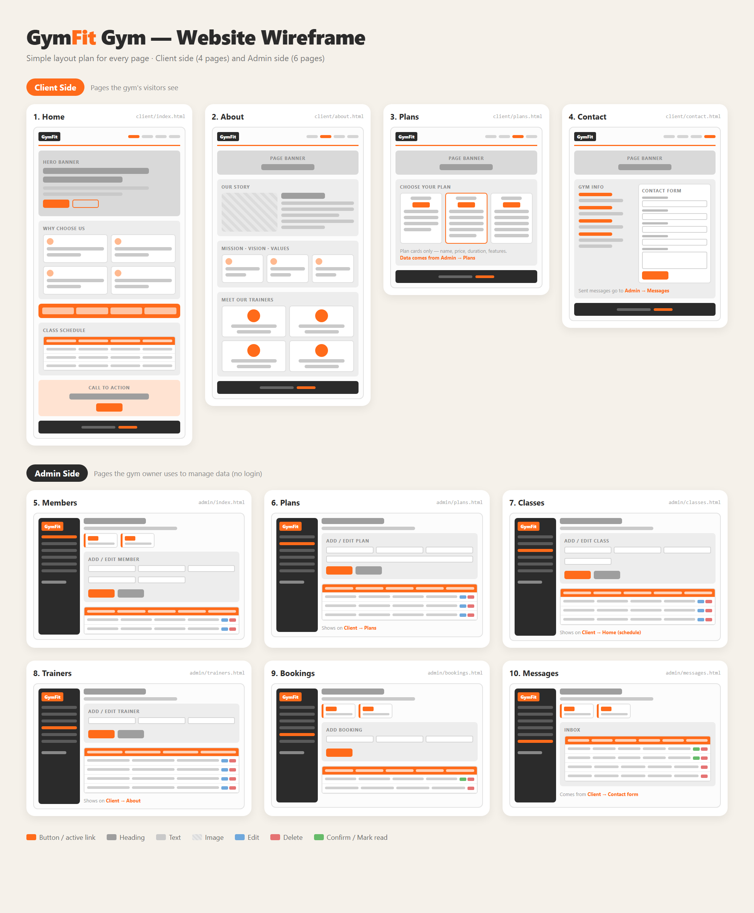

# GymFit Gym

A simple gym website made with plain HTML, CSS and JavaScript.
There is no server and no login. All data is saved in the browser (localStorage).



## How to run in VS Code

1. Open the `gymfit-gym` folder in VS Code (File > Open Folder).
2. Install the **Live Server** extension, if you don't have it yet.
3. Right-click `client/index.html` and choose **Open with Live Server**.
   (Or just double-click `client/index.html` to open it in your browser.)
4. For the admin side, open `admin/index.html` (or click "Admin Panel" in the website footer).

## Folder structure

```
gymfit-gym/
├── client/
│   ├── index.html      Client: Home (class schedule)
│   ├── about.html      Client: About (trainers)
│   ├── plans.html      Client: Membership plans
│   ├── contact.html    Client: Contact form
│   ├── css/style.css   Client styles
│   ├── js/storage.js   Shared: save/load data (used by client AND admin)
│   └── js/main.js      Client JavaScript
└── admin/
    ├── index.html      Admin: Members
    ├── plans.html      Admin: Plans
    ├── classes.html    Admin: Classes
    ├── trainers.html   Admin: Trainers
    ├── bookings.html   Admin: Bookings
    ├── messages.html   Admin: Contact messages
    ├── admin.css       Admin styles
    └── js/             One JavaScript file per admin page
```

## How client and admin are connected

| Change in admin page | Shows on client page |
|---|---|
| Plans | client/plans.html |
| Classes | client/index.html (class schedule) |
| Trainers | client/about.html |
| Contact form (client) | admin/messages.html |

To reset all data, open the browser console (F12) and run `localStorage.clear()`.
